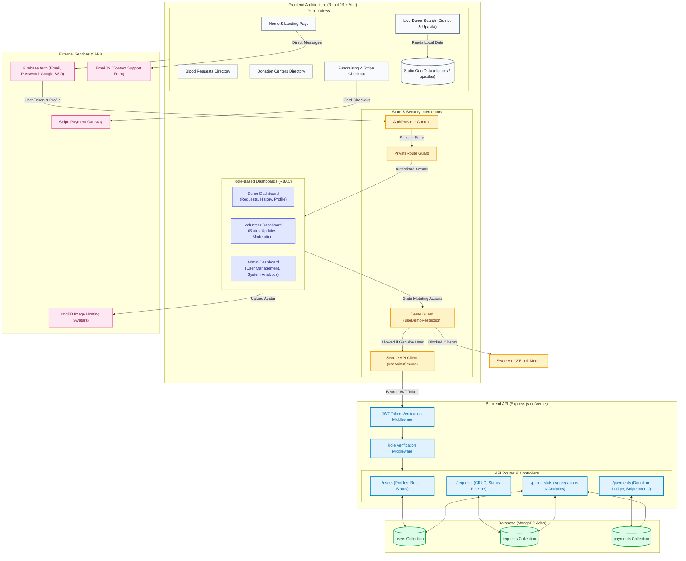

# Hemovia - Technical Architecture

Detailed technical documentation for the Hemovia platform. For project overview, setup, and deployment, see [README.md](README.md).

---

## Architecture Overview


---

## Project Structure

```
Hemovia-Frontend/
├── public/                       # Static public assets
│   ├── district.json             # Bangladesh districts dataset
│   └── upazila.json              # Bangladesh upazilas dataset
├── src/
│   ├── assets/                   # Brand logos, icons, and static images
│   ├── Components/               # Reusable presentational components
│   │   ├── Aside/                # Collapsible dashboard sidebar (Aside.jsx, asideConfig.js)
│   │   ├── BloodCompatibility/   # Compatibility matrix (Matches, Chart, Data)
│   │   ├── DemoUserBadge/        # Floating demo session badge
│   │   ├── Footer/               # Platform footer with quick links
│   │   ├── Home/                 # Modular landing page sections (Hero, HowItWorks, Centers, Impact, Contact)
│   │   ├── Navbar/               # Responsive top navigation (NavLinks, UserMenu, ThemeToggle)
│   │   ├── SkeletonLoader/       # Shimmer loading state card placeholders
│   │   └── UI/                   # Reusable UI primitives (Button, Card, Input, Badge)
│   ├── config/
│   │   └── emailjs.js            # EmailJS configuration wrapper and validator
│   ├── Dashboard/                # Role-based dashboard modules (< 200 lines per module)
│   │   ├── AddRequest/           # Blood request creation form (AddRequest, AddRequestForm)
│   │   ├── AdminDashboard/       # Admin analytics, stat cards, recent platform activities
│   │   ├── AllRequest/           # Blood request moderation directory with pagination
│   │   ├── AllUsers/             # User directory, status toggling, and role assignment
│   │   ├── DonorDashboard/       # Donor stats, personal requests, and quick actions
│   │   ├── MyRequest/            # Personal donation request history with responsive tables
│   │   ├── Profile/              # Profile editor with ImgBB avatar integration
│   │   ├── VolunteerDashboard/   # Volunteer request moderation and platform coordination
│   │   └── utils/                # Dashboard helpers (requestHelpers.jsx)
│   ├── DashboardLayout/          # Dashboard layout wrapper with sidebar and demo badge
│   ├── Donate/                   # Stripe checkout form and public donor ledger
│   ├── Firebase/
│   │   └── firebase.config.js    # Firebase SDK initialization
│   ├── Hooks/
│   │   ├── useAxios.jsx          # Public API Axios instance
│   │   ├── useAxiosSecure.jsx    # Secure Axios instance with JWT bearer interceptor
│   │   └── useDemoRestriction.js # Interceptor blocking write mutations for demo sessions
│   ├── Pages/                    # Public route pages with decomposed subcomponents
│   │   ├── About/                # Platform mission, team, values, and impact stats
│   │   ├── CenterDetails/        # Individual donation center info and map placeholder
│   │   ├── DonationCenters/      # Verified blood bank directory with search and filters
│   │   ├── DonationRequests/     # Public donation requests directory and cards
│   │   ├── EditRequest/          # Request edit form with validation
│   │   ├── FAQ/                  # Interactive accordion FAQ and support contact box
│   │   ├── Login/                # Login authentication form with demo auto-fill selector
│   │   ├── PaymentCancelled/     # Stripe payment cancellation view
│   │   ├── PaymentSuccess/       # Stripe payment confirmation receipt
│   │   ├── Register/             # User registration with direct ImgBB image upload
│   │   ├── Search/               # Donor search engine with district & upazila filters
│   │   ├── ViewRequest/          # Request details modal and donor commitment workflow
│   │   ├── utils/                # Page utilities (centerHelpers.js, faqData.js)
│   │   ├── BloodCompatibilitySection.jsx # Blood type compatibility matrix
│   │   ├── ForgetPassword.jsx    # Password recovery view
│   │   └── Home.jsx              # Landing page root
│   ├── Provider/
│   │   └── AuthProvider.jsx      # Global authentication and user role context provider
│   ├── RootLayout/               # Main layout wrapper (Navbar, Footer, dynamic theme init)
│   ├── Routes/
│   │   ├── PrivateRoute.jsx      # Authentication and authorization route guard
│   │   └── router.jsx            # React Router v7 route definitions
│   ├── styles/
│   │   ├── designSystem.js       # Design tokens (colors, typography, spacing, shadows)
│   │   └── globals.css           # Global CSS variables and utility classes
│   ├── index.css                 # Tailwind CSS v4 and DaisyUI v5 stylesheet
│   └── main.jsx                  # Application entry point and React root mount
├── .env.local                    # Local environment variables (not committed)
├── .firebaserc                   # Firebase project mapping
├── .gitignore                    # Git ignore specifications
├── eslint.config.js              # ESLint configuration
├── firebase.json                 # Firebase Hosting configuration
├── index.html                    # Single-page application HTML entry point
├── LICENSE                       # Project license and usage terms
├── package.json                  # Dependencies, metadata, and build scripts
├── vercel.json                   # Vercel SPA routing rewrites configuration
└── vite.config.js                # Vite build configuration and Tailwind plugin
```

---

## Design Patterns

| Pattern | Usage |
|---|---|
| **Context Provider** | `AuthProvider` manages global auth state, user profile, and role |
| **Higher-Order Component** | `PrivateRoute` wraps protected dashboard routes to guard unauthorized access |
| **Custom Interceptor Hook** | `useAxiosSecure` injects JWT bearer tokens; `useDemoRestriction` intercepts write actions |

---

## Authentication & Security

### Authentication Flow

```
[Client] → Firebase Auth (Email / Google SSO) → JWT Access Token
    ↓
AuthProvider fetches role from API → sets role in context
    ↓
PrivateRoute checks auth state → redirects unauthenticated users
    ↓
Role-specific dashboard and navigation rendered
```

### Security Layers

1. **Firebase Authentication** - Manages user credentials, session tokens, and Google OAuth
2. **JWT Bearer Tokens via Axios Interceptor** - `useAxiosSecure.jsx` attaches the Firebase access token to every protected API request:
   ```javascript
   config.headers.Authorization = `Bearer ${user?.accessToken}`;
   ```
3. **Role-Based Access Control (RBAC)** - Dashboard menus and routes dynamically render based on `donor`, `volunteer`, or `admin` role from context
4. **Demo User Write Guard** - `useDemoRestriction.js` intercepts all write actions for demo accounts and shows a SweetAlert2 block modal:
   ```javascript
   if (isDemoUser(user.email)) {
     Swal.fire({ title: "Demo User Restriction!", icon: "warning", ... });
     return true; // block the action
   }
   ```
5. **Environment Variable Isolation** - All sensitive keys are stored in `.env.local` and never committed to version control

---

## Database Schema

### Users Collection
```json
{
  "_id": "ObjectId",
  "name": "Jane Doe",
  "email": "jane@example.com",
  "role": "donor",         // donor | volunteer | admin
  "status": "active",      // active | blocked
  "district": "Dhaka",
  "upazila": "Dhanmondi",
  "bloodGroup": "O+",
  "imageUrl": "https://i.ibb.co/avatar.jpg"
}
```

### Requests Collection
```json
{
  "_id": "ObjectId",
  "requesterName": "Jane Doe",
  "requesterEmail": "jane@example.com",
  "recipientName": "John Connor",
  "recipientDistrict": "Dhaka",
  "recipientUpazila": "Mirpur",
  "hospitalName": "Dhaka Medical College Hospital",
  "fullAddress": "Zahir Raihan Rd, Dhaka",
  "bloodGroup": "A+",
  "donationDate": "2026-06-15",
  "donationTime": "10:30",
  "requestMessage": "Urgent donor needed for cardiac surgery.",
  "mobile": "017XXXXXXXX",
  "donation_status": "pending",  // pending | inprogress | done | canceled
  "donorName": "John Doe",
  "donorEmail": "donor@example.com"
}
```

### Payments Collection
```json
{
  "_id": "ObjectId",
  "donorName": "Sarah Lee",
  "donorEmail": "sarah@example.com",
  "amount": 50.00,
  "paidAt": "2026-05-24T18:23:26Z",
  "transactionId": "pi_3MtwMQ2eZvKYlo2C1OBxxxxx"
}
```

---

## Performance & Responsive Design

### Performance Optimizations
- **Static Geographic Data Offloading**: `district.json` (12KB) and `upazila.json` (67KB) are served from the `public/` directory, eliminating redundant API calls for static reference data
- **Skeleton Loaders**: `SkeletonLoader.jsx` renders animated card placeholders across all data-loading views to reduce perceived latency and prevent layout shifts
- **Centralized Axios Instances**: Reusable `useAxios` and `useAxiosSecure` hooks prevent redundant client configurations and manage connection pooling
- **Server-Side Aggregation**: The `/public-stats` endpoint uses MongoDB aggregate pipelines, keeping response payloads minimal even at scale

### Responsive Design
- **Mobile-First Grid System**: Tailwind responsive breakpoints (sm / md / lg / xl) with fluid card grids
- **Collapsible Sidebar**: Dashboard aside collapses to icon-only mode on smaller screens
- **DaisyUI v5 Theme Engine**: Light/dark toggle persisted in localStorage and synchronized across components via custom `themeChange` events
- **Accessibility (a11y)**: Semantic HTML, labeled form controls, visible focus states, and WCAG AA color contrast ratios
